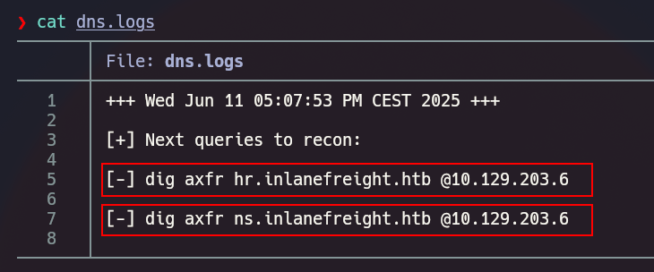
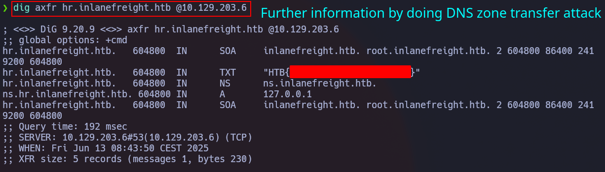

## Description

**Hit-The-Dns** is a modern DNS recon tool written in bash which will help you during the DNS recon similar to tools like `subfinder` or `dnsenum`.

>[Github Link](https://github.com/juanbelin/Hit-The-Dns)

## Installation 
```
wget https://raw.githubusercontent.com/juanbelin/Hit-The-Dns/refs/heads/main/hit-the-dns.sh
```

```
chmod +x hit-the-dns.sh
```

## Example Usage
> This example was done using [Attacking DNS Lab from HTB Academy](https://academy.hackthebox.com/module/116/section/1512).

### DNS Fuzzing 
```
./hit-the-dns -d inlanefreight.htb -i 10.129.203.6 -w ~/seclists/Discovery/DNS/subdomains-top1million-110000.txt
```
<iframe class="video-embed" src="https://www.youtube-nocookie.com/embed/jjW2ubTnhqw" title="YouTube video" loading="lazy" allow="accelerometer; autoplay; clipboard-write; encrypted-media; gyroscope; picture-in-picture" allowfullscreen></iframe>


### DNS Fuzzing verbose mode  
`-v` or `--verbose` in order to view fuzzing attempts.

```
./hit-the-dns -d test.com -i 10.129.203.6 -w ~/seclists/Discovery/DNS/subdomains-top1million-110000.txt -v
```

### Checking dns.logs and following the next step
The **dns.logs** file will give you the next step in the recon (zone transfer attack) according with the subdmains that the tool has found during the fuzzing.

<iframe class="video-embed" src="https://www.youtube-nocookie.com/embed/u2cVWcbJr-k" title="YouTube video" loading="lazy" allow="accelerometer; autoplay; clipboard-write; encrypted-media; gyroscope; picture-in-picture" allowfullscreen></iframe>







## Usage 

```
./hit-the-dns -d domain.com -i 10.10.2.15 -w /path/to/wordlist.txt <-v>
```

```
./hit-the-dns.sh


 █████   █████  ███   █████                                                             
░░███   ░░███  ░░░   ░░███                                                              
 ░███    ░███  ████  ███████                                                            
 ░███████████ ░░███ ░░░███░                                                             
 ░███░░░░░███  ░███   ░███                                                              
 ░███    ░███  ░███   ░███ ███                                                          
 █████   █████ █████  ░░█████                                                           
░░░░░   ░░░░░ ░░░░░    ░░░░░                                                            

              █████    █████                  ██████████   ██████   █████  █████████    
             ░░███    ░░███                  ░░███░░░░███ ░░██████ ░░███  ███░░░░░███   
             ███████   ░███████    ██████     ░███   ░░███ ░███░███ ░███ ░███    ░░░    
            ░░░███░    ░███░░███  ███░░███    ░███    ░███ ░███░░███░███ ░░█████████    
              ░███     ░███ ░███ ░███████     ░███    ░███ ░███ ░░██████  ░░░░░░░░███   
              ░███ ███ ░███ ░███ ░███░░░      ░███    ███  ░███  ░░█████  ███    ░███   
              ░░█████  ████ █████░░██████     ██████████   █████  ░░█████░░█████████    
               ░░░░░  ░░░░ ░░░░░  ░░░░░░     ░░░░░░░░░░   ░░░░░    ░░░░░  ░░░░░░░░░     

 [+] Usage:
	-d/--domain <domain> -w/--wordlist </path/to/wordlist> -i/--ip <IP>
	-v/--verbose = Verbose mode
	-h --> Show help panel
```

> Do not forget adding the domain to the `/etc/hosts` file
> `nano /etc/hosts` and add a new line which contains '10.10.2.1 domain.com'

## Hit-The-Dns with Dnsenum comparation
Some tools such as dnsemun does not always find the subdomains even if they exist in the DNS because of the way it implements threads and filters.

<iframe class="video-embed" src="https://www.youtube-nocookie.com/embed/eyP8REu-1g0" title="YouTube video" loading="lazy" allow="accelerometer; autoplay; clipboard-write; encrypted-media; gyroscope; picture-in-picture" allowfullscreen></iframe>
